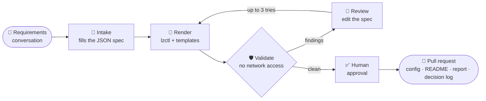

# 🏗️ Terraform Landing Zone Agent Skill

### The goal: from a requirements conversation to a review-ready landing zone PR.

A portable **Agent Skill** plus a hosted **ADK agent on Cloud Run** that turns landing zone requirements into validated Terraform for **GCP, Azure, AWS or OpenStack**, delivered as a GitHub pull request.

[**Skill**](.agents/skills/landing-zone/SKILL.md) · [**Contributing**](CONTRIBUTING.md) · [**Discussions**](https://github.com/loriamichaelj/terraform-landing-zone-agent-skill/discussions)

---

## 💡 Why

Standing up a compliant landing zone takes **weeks of senior platform time**, mostly translating requirements into hundreds of module settings. The reference foundations are solid, but teams misconfigure them in predictable ways, and policy violations surface late.

LLMs are great at intake and terrible at writing reviewable infrastructure code from scratch. This project leans on the first and guards against the second:

> **The model picks values. Templates decide structure. Humans approve. The pipeline applies.**

## ✨ Highlights

<table>
<tr>
<td width="50%" valign="top">

### 🧱 Vetted baselines only
Composes **Fabric FAST**, **Azure Verified Modules** and **Control Tower + AFT**, and fills in their configuration. **No freeform HCL. Ever.**

</td>
<td width="50%" valign="top">

### 🎯 Deterministic output
`lzctl` renders templates with **no model in the loop**. Same spec + same skill version = **byte-identical output** on every host.

</td>
</tr>
<tr>
<td valign="top">

### 🛡️ Validated before you see it
fmt · validate · tflint · trivy · checkov · OPA policies · upstream schemas, in an **isolated job with no network access**. Failures are fixed in the spec, not the code.

</td>
<td valign="top">

### 🔒 Blast radius: one pull request
The agent **never runs `terraform apply`** and holds no org-level credentials. Merges need code-owner approval; apply runs in your existing pipeline.

</td>
</tr>
<tr>
<td valign="top">

### 🧳 Runs where you work
One `SKILL.md` package for **Codex**, **Gemini CLI**, **Grok Build**, **DeepSeek-backed hosts** and the hosted agent.

</td>
<td valign="top">

### 📜 Every choice explained
Each PR ships with a **decision log**: every non-default value records who chose it and why.

</td>
</tr>
</table>

## ⚙️ How it works

| Step | What happens |
| --- | --- |
| 📝 **Intake** | A conversation fills a landing zone spec, checked against a schema derived from the baseline. Missing mandatory fields get follow-up questions. |
| 🧩 **Render** | `lzctl` turns the spec into FAST YAML datasets and a Terraform root module per stage, from templates. |
| 🛡️ **Validate** | Static checks and policy-as-code run in an isolated job. Each finding maps back to the spec field that caused it. |
| 🔧 **Review** | The spec is fixed and re-rendered, at most 3 times; then the findings go to you. |
| 🚀 **Publish** | After you approve, a PR opens with the config, a README, the validation report and the decision log. |

## ☁️ Clouds and profiles

| Cloud | Baseline | Hierarchy |
| --- | --- | --- |
|  | Cloud Foundation Fabric FAST (YAML datasets) | Organization › folders › projects |
|  | AVM for Platform Landing Zones | Tenant root › management groups › subscriptions |
|  | Control Tower + AFT + SCPs | Organization › OUs › accounts |
|  | Our own module set | Domains › projects |

| Profile | For | Adds |
| --- | --- | --- |
| 🌱 **Starter** | Sandboxes, proofs of concept | Hierarchy, one environment, central logging, budgets |
| 🏢 **Standard** *(default)* | Most enterprise workloads | dev/stage/prod, hub-and-spoke network, guardrails, IAM groups, 1-year audit logs |
| 🏦 **Regulated** | SOC 2, PCI-DSS, HIPAA scope | Customer-managed keys, private-only access, service perimeters, stricter policy pack, break-glass |

## 📚 Reference

| | Page | What it covers |
| --- | --- | --- |
| 🧩 | [Skill package](.agents/skills/landing-zone/SKILL.md) | The `SKILL.md` workflow, spec fields and the GCP baseline reference, as agents read them |

## 🤝 Contributing

The design is settled enough to build on and still open to change: only GCP renders so far. **Design review and cloud expertise are especially welcome**: Azure ALZ, AWS Control Tower and OpenStack gotchas, and spec schema critiques.

| I want to… | Go to |
| --- | --- |
| 💬 Ask a question or share an idea | [Discussions](https://github.com/loriamichaelj/terraform-landing-zone-agent-skill/discussions) |
| 🐛 Report a bug, request a feature, propose a design change | [New issue](https://github.com/loriamichaelj/terraform-landing-zone-agent-skill/issues/new/choose) |
| 🛠️ Send a change | [CONTRIBUTING.md](CONTRIBUTING.md): branch from `dev`, Conventional Commits PR title, one code-owner approval, squash-merged |
| 🔐 Report a vulnerability | Privately, per [SECURITY.md](SECURITY.md) |

Need help? See [SUPPORT.md](SUPPORT.md).

## 📄 License

Licensed under the [Apache License 2.0](LICENSE).

Cloud Foundation Fabric, Azure Verified Modules, AWS Control Tower and the open Agent Skills format.
  
⭐ <b>Star the repo</b>

